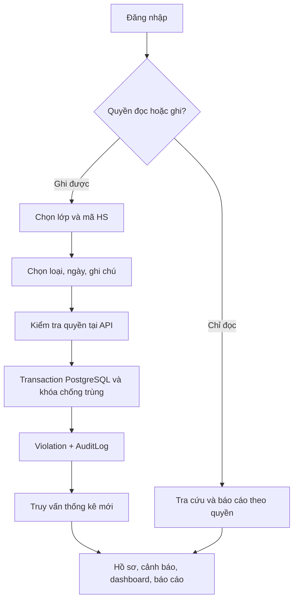
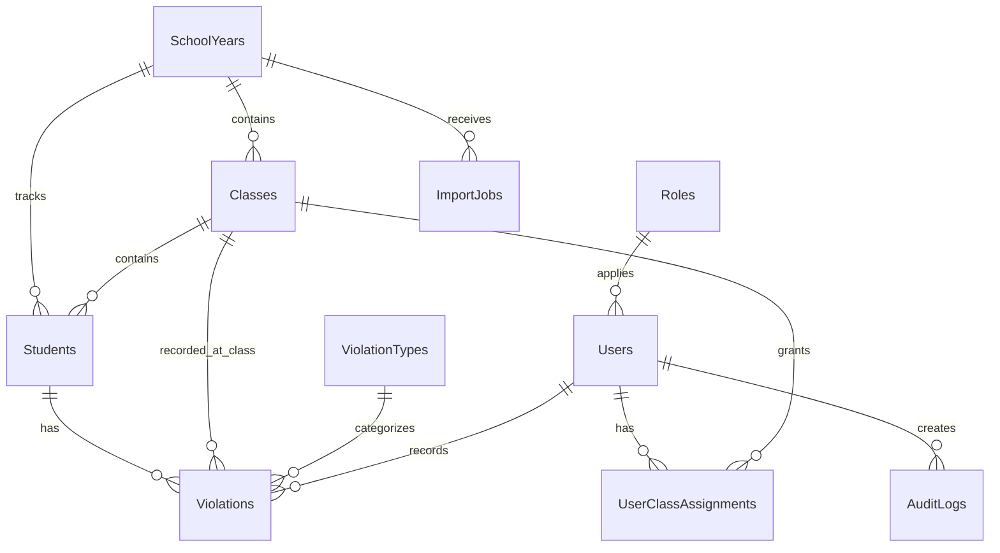

# Báo cáo phân tích workbook gốc – 02/11/2026

**Nguồn:** `PHÔI NHẬP LIỆU BẢN FULL MỚI 2026.xlsx`, đọc trực tiếp định dạng OOXML (XML và shared strings). Không đánh giá công thức bằng cách chỉnh sửa file gốc. **Tài liệu này không trích xuất tên, ngày sinh hay mã cá nhân học sinh.**

## 1. Kiểm kê

- **58 sheet**: 9 sheet nghiệp vụ (`TRANG_CHU`, `DULIEU_HOCSINH`, `CAU_HINH`, `NHAP_LIEU`, `NHAT_KY_VI_PHAM`, `TRA_CUU`, `DASHBOARD`, `CANH_BAO`, `BAO_CAO_TUAN`), **48 sheet lớp**, 1 `HUONG_DAN`.
- `DULIEU_HOCSINH!A5:F2265`: tiêu đề dòng 5, 2.260 hồ sơ tại dòng 6–2265, đủ 6 cột; không thấy mã trùng hoặc ô thiếu. Các ngày sinh có dạng `dd/mm/yyyy`.
- 48 lớp: khối 10 **821 HS**, khối 11 **770 HS**, khối 12 **669 HS** (tổng 2.260).
- `CAU_HINH!A6:D10`: 5 ngưỡng cảnh báo; `F6:F16`: đúng 11 loại vi phạm; `H6:H53`: đúng 48 lớp.
- `NHAT_KY_VI_PHAM!A5:K5005`: 5.000 dòng mẫu có công thức; **không có ô nhập dữ liệu tại B/I/K từ dòng 6–5005**. Không được import thành 5.000 lượt vi phạm.
- Dữ liệu học sinh là dữ liệu gốc. Các trường thống kê, họ tên trong nhật ký và cảnh báo là kết quả tra cứu hoặc tính toán, không phải dữ liệu cần nhân bản.
- Xem `WORKBOOK_AUDIT.json` để có số lượng ô dữ liệu, công thức, kích thước và danh sách đầy đủ 58 sheet mà không kèm PII.

## 2. Chuyển đổi từng nhóm sheet

| Sheet gốc | Đầu vào/logic | Kết quả ở ứng dụng |
|---|---|---|
| `TRANG_CHU` | 6 vùng điều hướng, tên trường/năm học | 5 tab mobile + quản trị và nhật ký |
| `DULIEU_HOCSINH` | A:F: ID, STT, họ tên, lớp, ngày sinh, giới tính | `students`, `classes`, `school_years`; tìm kiếm và hồ sơ |
| `CAU_HINH` | Mức 0/1–2/3–4/5–6/7+, 11 loại, 48 lớp | `warning_rules`, `violation_types`, `classes`; kiểm tra khi sửa |
| `NHAP_LIEU` | Chọn C6 lớp, C7 mã HS, C11 loại; VLOOKUP tự hiển thị C8:C10, ngày TODAY | Form mobile chọn đúng mã, hiển thị lớp và họ tên; server lưu thời gian |
| `NHAT_KY_VI_PHAM` | B/I/K nhập; C:F tra cứu; G/H/J ngày/thứ/giờ công thức | `violations` + snapshot lớp, `happened_on` và `recorded_at` cố định; audit thay đổi |
| `TRA_CUU` | COUNTIFS 11 loại, SUM, cảnh báo và đề nghị GVCN | `/students/{code}` tính từ vi phạm trạng thái active |
| `DASHBOARD` | COUNTIFS hôm nay, theo lớp, loại; tổng | `/dashboard` với bộ lọc, 4 KPI + từng lớp/loại |
| `CANH_BAO` | Mỗi HS 11 COUNTIFS, tổng, mức, đề nghị | `/warnings` tính lại theo từng HS từ nhật ký gốc |
| `BAO_CAO_TUAN` | Mặc định Mon–Sat, COUNTIFS ngày inclusive, theo lớp/loại | `/reports/weekly` + `.pdf` + `.xlsx`, ngày bao gồm hai đầu mốc |
| 48 sheet lớp | Lọc học sinh, tổng vi phạm, nghiêm trọng, mức và đề nghị | `/classes/{id}/summary` trả dữ liệu động theo 1 lớp |
| `HUONG_DAN` | Hướng dẫn Excel bằng ô văn bản | Tài liệu cài đặt và hướng dẫn thao tác nội bộ |

## 3. Công thức cốt lõi và phép chuyển chính xác

### 3.1. Tổng lượt và cảnh báo

`TRA_CUU!E6:E16` là 11 COUNTIFS theo `Mã HS` + `Loại vi phạm`, `E17 = SUM(E6:E16)`. `E18` và `CANH_BAO!R6`:

```text
IF(Hút thuốc >= 1 OR Đánh nhau >= 1) → Cảnh báo cao
ELSE 0 → Tốt
ELSE 1–2 → Nhắc nhở
ELSE 3–4 → Cần quan tâm
ELSE 5–6 → Cảnh báo
ELSE >=7 → Cảnh báo cao
```

Mức được tính theo tổng các **lượt vi phạm** (không phải số ngày khác nhau, không phải số loại khác nhau). 11 loại có cùng trọng số. Ngưỡng mặc định tương ứng `CAU_HINH!A6:D10`. Ở ứng dụng, khi quản trị sửa ngưỡng (bảo đảm khoảng liên tục, không trùng, bắt đầu 0, cuối mở), mức sẽ được tính lại trên nhật ký; ưu tiên Hút thuốc/Đánh nhau vẫn cố định.

### 3.2. Đề nghị GVCN (`TRA_CUU!E19` và `CANH_BAO!S6`)

**Thứ tự IF bắt buộc bảo toàn**:

1. Có ít nhất 1 Hút thuốc/Đánh nhau → `Phối hợp Ban Đức dục và CMHS xử lý ngay vi phạm nghiêm trọng.`
2. Nghỉ học không phép từ 2 → `Xác minh nguyên nhân nghỉ học và liên hệ CMHS.`
3. Không đội mũ bảo hiểm từ 2 → `Tăng cường nhắc nhở an toàn giao thông.`
4. Tổng lượt từ 7 → `Phối hợp Ban Đức dục và CMHS.`
5. Tổng lượt từ 5 → `Tăng cường theo dõi, trao đổi CMHS.`
6. Tổng lượt từ 3 → `Làm việc trực tiếp, xác định nguyên nhân.`
7. Đi học muộn từ 3 → `Theo dõi giờ đến trường; đi muộn lặp lại.`
8. Tổng lượt từ 1 → `Nhắc nhở và tiếp tục theo dõi.`
9. Còn lại → `Tiếp tục duy trì.`

**Lưu ý logic:** nhánh `Đi học muộn từ 3` bị nhánh `Tổng lượt từ 3` ở trên chặn trong mọi trường hợp. Mã nguồn **giữ nguyên thứ tự** để không tự sửa quy định nghiệp vụ. Nếu nhà trường muốn 3 lần đi muộn có đề nghị chuyên biệt, cần phê duyệt thay đổi ưu tiên.

### 3.3. Thời gian

`NHAP_LIEU!C12` dùng `TODAY()`, `NHAT_KY_VI_PHAM!J6` dùng `NOW()` và `G6 = INT(J6)`; NOW/TODAY tính lại khi mở/tính workbook, **không thể dùng làm thời gian lịch sử cố định**. App thay bằng `happened_on` kiểu `date` (mặc định ngày hiện tại của Việt Nam, cho phép chọn) và `recorded_at` kiểu UTC cố định của server. Khi chỉnh sửa, `recorded_at` không đổi; `updated_at` thay đổi và có audit.

### 3.4. Báo cáo tuần

`BAO_CAO_TUAN!A6 = TODAY()-WEEKDAY(TODAY(),2)+1`, `C6 = A6+5`. COUNTIFS với `G >= A6` và `G <= C6`; ngày kết thúc **được tính vào**. Mức cảnh báo lớp trong tuần tính theo tổng lượt trong kỳ của **cả lớp**, không phải cảnh báo cá nhân; đây là hai chỉ số khác nhau.

## 4. Phát hiện lỗi/khác biệt có căn cứ trong workbook

| Hiện tượng | Bằng chứng trong định dạng XML | Quyết định chuyển đổi |
|---|---|---|
| Các tổng/cảnh báo/đề nghị nhiều dòng không là công thức | `CANH_BAO` các cột Q/R/S mỗi cột chỉ **36 công thức** trong 2.260 hồ sơ; phần lớn dòng khác lưu số/text 0/Tốt/đề nghị cố định | App **tính từ nhật ký** cho tất cả HS; không bắt chước các giá trị tĩnh |
| Nhiều dòng sheet lớp có tổng tĩnh | Ví dụ `10A01`: Q/R/S mỗi cột chỉ 1 công thức ở dòng đầu học sinh, các dòng sau tĩnh | Tính theo query `count` cho tất cả HS |
| Dashboard và báo cáo tuần nhiều tổng tĩnh | `DASHBOARD!M11` có công thức, `M12:M58` là giá trị tĩnh; `BAO_CAO_TUAN!M9` có công thức, `M10:M56` chủ yếu tĩnh | Tính trực tiếp từ dữ liệu gốc; dự kiến khác Excel nếu có dữ liệu mới |
| Thời gian nhật ký thiếu công thức ở phần lớn dòng | A/G/H/J chỉ có 79 công thức tại một số dòng; C:F có 5.000 công thức | Chuyển thành bản ghi DB có timestamp bất biến |
| `Số loại vi phạm` trên sheet lớp hiển thị 11 | Ví dụ `10A01!J5 = 11`, bất kể có phát sinh vi phạm hay không | Trả **hai chỉ tiêu**: `configured_types=11` và `different_types` là số loại thực phát sinh; mobile hiển thị loại thực phát sinh |
| Workbook 5.000 dòng mẫu | `NHAT_KY_VI_PHAM!A5:K5005` | DB mở rộng, không import dòng trống |
| Form chưa tự lưu | `NHAP_LIEU!A3` hướng dẫn nhập thủ công ở nhật ký | Form mobile ghi thông qua API transaction |

**Nguyên tắc:** Đối chiếu **logic công thức hợp lệ** thay vì buộc thống kê ứng dụng trùng các giá trị cứng lỗi thời. Bất kỳ thay đổi nghiệp vụ nào khác phải được nhà trường xác nhận.

## 5. Phép đối chiếu đã kiểm tra

| Tình huống | Excel được kỳ vọng theo công thức | Backend | Kết luận |
|---|---|---|---|
| Workbook hiện tại, chưa có vi phạm | Các loại và tổng = 0 | Import tạo 0 vi phạm | Tương đương |
| Số HS và lớp | 2.260 / 48 | Import tạm thực tế 2.260 / 48 | Tương đương |
| 0,1,2,3,4,5,6,7 lượt | Tốt, Nhắc nhở×2, Cần quan tâm×2, Cảnh báo×2, Cảnh báo cao | Unit test đạt | Tương đương |
| Ít nhất 1 Hút thuốc/Đánh nhau | Cảnh báo cao | Unit test đạt | Tương đương |
| 2 Nghỉ KP hoặc 2 Không mũ | Đề nghị ưu tiên ở nhánh IF tương ứng | Unit test đạt | Tương đương |
| Mặc định tuần Mon–Sat | Cột ngày A6/C6, bao gồm ngày đầu/cuối | `week_window()` tính tương ứng | Tương đương thiết kế |
| Sau nhập mới, ở những dòng tổng/cảnh báo cố định của Excel | Có nguy cơ giữ số liệu tĩnh cũ | Luôn truy vấn bảng `violations` | **Khác biệt có chủ đích để sửa lỗi** |
| Số loại vi phạm ở sheet lớp | Luôn hiển thị 11 | Thực tế phát sinh 0–11; có thêm `configured_types=11` | Hai định nghĩa được tách rõ |
| Khả năng phân quyền người nhập | Excel không có backend auth | RBAC + cấp lớp | **Quy tắc mới cần xác nhận** |

## 6. Sơ đồ luồng xử lý



## 7. Kiến trúc dữ liệu



Các bảng `WarningRules` và `ImportJobs` được giữ độc lập để quản lý cấu hình và lịch sử nhập. Mã học sinh được ràng buộc unique; loại vi phạm, lớp, người nhập, năm học có FK; bảng violations có index theo ngày/lớp và idempotency key unique.

**Đối chiếu bổ sung:** Đã kiểm tra số học sinh liệt kê ở cả 48 sheet lớp đối với dữ liệu gốc trong `DULIEU_HOCSINH`; **48/48 lớp có số dòng học sinh khớp**, không có lớp chênh lệch sĩ số.
